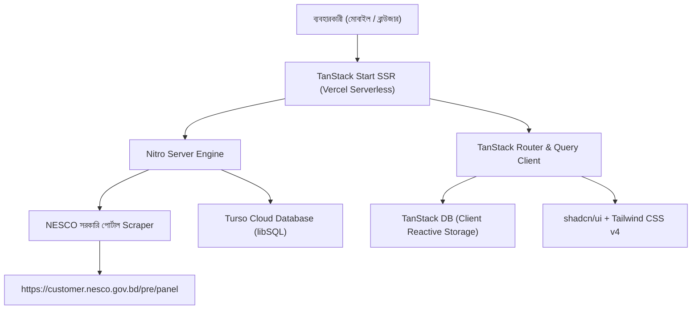

# ⚡ বিলবাড়ি (BillBari)
### প্রিমিয়াম ও মোবাইল-ফার্স্ট বিদ্যুৎ বিল ও রিচার্জ সহজ হিসাব প্ল্যাটফর্ম
> **A Modern, Mobile-First Electricity Bill & Prepaid Recharge Analytics Platform for NESCO (Northern Electricity Supply Company) Consumers in Bangladesh.**

[](https://billbari.vercel.app)
[](https://turso.tech)
[](https://tanstack.com/start)
[](https://ui.shadcn.com)
[](LICENSE)

---

## 🌍 বাস্তব প্রেক্ষাপট: এটি কেন দরকার? (Why BillBari?)

বাংলাদেশে রাজশাহী ও রংপুর বিভাগের ১৬টি জেলার লাখ লাখ পরিবার ও ব্যবসা প্রতিষ্ঠান **NESCO (Northern Electricity Supply Company)**-এর প্রিপেইড মিটার ব্যবহার করে। তবে প্রিপেইড বিদ্যুতের দৈনন্দিন ব্যবহারে সাধারণ গ্রাহকরা প্রতিনিয়ত নানা সমস্যায় পড়েন:

### 🛑 সাধারণ মানুষের বাস্তব সমস্যাগুলো (The Core Problems):

1. **সরকারি পোর্টালের জটিলতা ও ধীরগতি:**
   - সরকারি `customer.nesco.gov.bd/pre/panel` পোর্টালটি মোবাইল-বান্ধব নয়।
   - সার্ভার প্রায়শই ধীরগতির থাকে এবং রিচার্জ বা ব্যবহারের তথ্য সহজে বের করা যায় না।

2. **টোকেন হারিয়ে যাওয়ার বিভ্রান্তি:**
   - বিকাশে বা দোকানে রিচার্জের পর অনেক সময় এসএমএস আসে না বা ডিলিট হয়ে যায়। ২০ সংখ্যার গোপন টোকেন নম্বর হারিয়ে গ্রাহক বিদ্যুৎহীন অবস্থায় বিপাকে পড়েন।

3. **বিদ্যুৎ হঠাৎ বন্ধ হয়ে যাওয়ার ভয় (Blackout Anxiety):**
   - সাধারণ মানুষ জানে না মিটারে থাকা অবশিষ্ট টাকায় কয়দিন চলবে। 
   - মধ্যরাতে বা ছুটির দিনে ব্যালেন্স হঠাৎ শূন্য হয়ে বিদ্যুৎ বন্ধ হয়ে যায়, কারণ দৈনন্দিন খরচের কোনো রিয়েল-টাইম ট্র্যাকিং নেই।

4. **স্ল্যাব ট্যারিফের ধোঁয়াশা (The Tariff Trap):**
   - বাংলাদেশ এনার্জি রেগুলেটরি কমিশন (BERC)-এর আবাসিক **LT-A ট্যারিফ** অনুযায়ী বিদ্যুতের ইউনিট বাড়লে বিলের রেট ধাপ অনুযায়ী দ্বিগুণ-তিনগুণ পর্যন্ত বেড়ে যায় (লাইফলাইন ৪.৬৩ ৳/ইউনিট থেকে শুরু করে সর্বোচ্চ ১৪.৬১ ৳/ইউনিট)।
   - মাসের শুরুতে অসচেতন ব্যবহারের কারণে গ্রাহক পরবর্তী উচ্চ স্ল্যাবে উঠে যায় এবং বিশাল অঙ্কের বিল পরিশোধ করতে বাধ্য হয়। মানুষ বুঝতে পারে না তাদের বাড়তি বিল কেন এলো।

5. **যন্ত্রপাতিভিত্তিক খরচের স্বচ্ছতার অভাব:**
   - ১টি এসি চালালে মাসে কত খরচ বাড়ে? ফ্রিজ বা গিজার চালালে কত টাকা বিদ্যুৎ বিল আসে? অধিকাংশ পরিবারের কাছে এর কোনো সুস্পষ্ট ধারণা নেই।

---

## 💡 বিলবাড়ি (BillBari) কীভাবে সমাধান দিচ্ছে?

বিলবাড়ি একটি স্বয়ংসম্পূর্ণ, দ্রুতগতির ও সুন্দর মোবাইল প্ল্যাটফর্ম যা NESCO গ্রাহকদের হাতে তাদের বিদ্যুৎ ব্যবহারের পূর্ণ নিয়ন্ত্রণ তুলে দেয়:

* ⚡ **১-ক্লিকে রিচার্জ হিস্ট্রি ও টোকেন পুনরুদ্ধার:** মিটার নম্বর দেওয়া মাত্রই সরকারি ডাটাবেস থেকে পূর্ববর্তী সব রিচার্জের পরিমাণ, তারিখ এবং ২০-ডিজিটের ভেন্ডিং টোকেন চোখের সামনে চলে আসে।
* 📅 **বাকি দিন ও দৈনিক খরচের হিসাব (Smart Expense Burn Trajectory):** ব্যবহারকারীর প্রতিদিনের ব্যালেন্স ও রিডিং স্ন্যাপশট ট্র্যাক করে স্বয়ংক্রিয়ভাবে জানিয়ে দেয় মিটারে থাকা টাকায় আনুমানিক আর কয়দিন চলবে এবং দিনে গড়ে কত টাকা বিদ্যুৎ পুড়ছে।
* 📊 **ইন্টারেক্টিভ চার্ট ও সহজ দৃশ্যমানতা:** কোন মাসে কত ইউনিট (kWh) খরচ হলো এবং কত টাকা রিচার্জ লাগলো — তা মোবাইল স্ক্রিনে সুন্দর চার্টে দেখা যায়।
* 🪜 **স্ল্যাব প্রগ্রেস ট্র্যাকার (Slab Alert):** গ্রাহক বর্তমানে লাইফলাইন, ধাপ ১, ২, ৩ নাকি উচ্চ ধাপে অবস্থান করছেন তা স্পষ্ট গ্রাফ ও সতর্কবার্তার মাধ্যমে জানিয়ে দেওয়া হয়, যেন পরিবারগুলো সচেতনভাবে স্ল্যাব সীমার মধ্যে খরচ রাখতে পারে।
* 💡 **যন্ত্রপাতিভিত্তিক বিদ্যুৎ খরচ ক্যালকুলেটর:** ১.৫ টন এসি, রেফ্রিজারেটর, ওয়াটার হিটার কিংবা সিলিং ফ্যান প্রতিদিন নির্দিষ্ট ঘণ্টা চালালে আনুমানিক কত টাকা ও ইউনিট বিদ্যুৎ খরচ হবে তা ক্যালকুলেটরে হিসেব করা যায়।
* 🔒 **বাস্তব ডেটা ও অনুমানের সুস্পষ্ট পার্থক্য:** সরকারি NESCO পোর্টালের আসল তথ্য এবং গাণিতিক হিসাব বা অনুমানের মধ্যে সুস্পষ্ট পার্থক্য বজায় রাখা হয়েছে।
* 🌙 **পূর্ণাঙ্গ ডার্ক মোড ও সহজ বাংলা ভাষা:** কোনো জটিল বা ভারী শব্দ পরিহার করে প্রাত্যহিক জীবনের সহজ ভাষায় তৈরি, সাথে চোখের আরামের জন্য সার্বক্ষণিক ডার্ক মোড সাপোর্ট।

---

## 🚀 প্রধান ফিচারসমূহ (Key Features)

| ফিচার | বিবরণ |
| :--- | :--- |
| 🔍 **সরাসরি নেসকো পোর্টাল ইন্টিগ্রেশন** | CSRF টোকেন নেগোসিয়েশন ও সেশন কুকি হ্যান্ডলিংয়ের মাধ্যমে `customer.nesco.gov.bd/pre/panel` থেকে লাইভ ডেটা স্ক্র্যাপিং। সরকারি সার্ভার বিলম্বিত হলে অফলাইন ক্যাশ ও রেফারেন্স মোড। |
| 📋 **ক্লিপবোর্ড থেকে পেস্ট সুবিধা** | মোবাইল বা কম্পিউটার থেকে ১-ক্লিকে মিটার নম্বর পেস্ট করে তাৎক্ষণিক অনুসন্ধান। |
| 🛡️ **সুরক্ষিত ইউজার একাউন্ট ও মিটার সংরক্ষণ** | ইমেইল/পাসওয়ার্ড (Salted scrypt হ্যাশিং) এবং Google OAuth লগইন। প্রিয় মিটারগুলো প্রোফাইলে সেভ করে রাখা যায়। |
| 📸 **দৈনিক ব্যালেন্স স্ন্যাপশট** | লগইন করা ব্যবহারকারীরা প্রতিদিনের মিটারের ব্যালেন্স সংরক্ষণ করে সময়ের সাথে সাথে খরচের ট্রেন্ড ট্র্যাক করতে পারেন। |
| 🔒 **লগইন-সুরক্ষিত দিনভিত্তিক ডেটা** | অতিথি ব্যবহারকারীদের জন্য দিন-ভিত্তিক দীর্ঘমেয়াদী হিসাবটি ব্লার করে প্রাইভেসি ও লগইন অনুপ্রেরণা রাখা হয়েছে। |
| ⚙️ **BERC LT-A অফিসিয়াল ট্যারিফ সিমুলেটর** | ইউনিট ও স্যাংশনড লোড অনুযায়ী লাইফলাইন ও ৬টি ধাপে এনার্জি চার্জ, ডিমান্ড চার্জ, মিটার রেন্ট, ৫% ভ্যাট এবং ১% প্রিপেইড রিবেট স্বয়ংক্রিয় হিসাব। |
| ☁️ **ক্লাউড ডাটাবেস ও অফলাইন রিয়্যাক্টিভ লেয়ার** | ক্লাউড **Turso (libSQL)** ডাটাবেসের সাথে সংযুক্ত, এবং ক্লায়েন্টে **TanStack DB** রিয়্যাক্টিভ ক্যাশিং লেয়ার। |

---

## 🏗️ টেক স্ট্যাক ও আর্কিটেকচার (Tech Stack)



- **Frontend & Fullstack SSR**: [TanStack Start](https://tanstack.com/start) + [Vite 8](https://vite.dev)
- **Routing & State**: [TanStack Router](https://tanstack.com/router) (Strict TypeScript Routes) + [TanStack Query](https://tanstack.com/query) v5
- **Client Reactive Data Layer**: [TanStack DB](https://tanstack.com/db) & `@tanstack/react-db`
- **UI Components & Theme**: [shadcn/ui](https://ui.shadcn.com) (`@base-ui/react` primitives), [Lucide React](https://lucide.dev), [next-themes](https://github.com/pacocoursey/next-themes) (Dark/Light mode)
- **Styling**: [Tailwind CSS v4](https://tailwindcss.com) with Modern Mauve Palette
- **Charts & Visualizations**: [Recharts](https://recharts.org)
- **Server Database**: [Turso](https://turso.tech) (libSQL) via `@libsql/client` (Cloud HTTP/WebSocket & Local SQLite compatible)
- **Server Engine**: [Nitro](https://nitro.build) for seamless Vercel deployment with Fluid Compute
- **Testing**: [Vitest](https://vitest.dev)

---

## 📂 প্রোজেক্টের ফোল্ডার স্ট্রাকচার (Project Structure)

```
billbari/
├── src/
│   ├── components/            # রি-ইউজেবল UI কম্পোনেন্ট (shadcn/ui)
│   │   ├── ui/                # বাটন, কার্ড, ইনপুট, ডায়ালগ, টোস্ট, টেবিল
│   │   ├── navbar.tsx         # মোবাইল-ফার্স্ট হেডার ও ন্যাভিগেশন
│   │   ├── footer.tsx         # ফুটার ও কপিরাইট
│   │   └── theme-toggle.tsx   # ডার্ক/লাইট মোড টগল
│   ├── features/              # ফিচারভিত্তিক মডিউলার আর্কিটেকচার
│   │   ├── auth/              # লগইন, রেজিস্ট্রেশন, সেশন ও গুগল অথ
│   │   ├── db/                # সার্ভার ডাটাবেস (Turso/libSQL) ও ক্লায়েন্ট TanStack DB
│   │   ├── nesco/             # নেসকো পোর্টাল স্ক্র্যাপার, ক্যাশ ও রেফারেন্স ডেটা
│   │   ├── snapshots/         # দৈনিক ব্যালেন্স স্ন্যাপশট ও বার্ন রেট হিসাব
│   │   └── tariffs/           # BERC LT-A স্ল্যাব লজিক ও অ্যাপ্লায়েন্স গাইড
│   ├── routes/                # TanStack ফাইল-বেসড টাইপড রুট
│   │   ├── __root.tsx         # রুট লেআউট ও প্রোভাইডারসমূহ
│   │   ├── index.tsx          # মূল ড্যাশবোর্ড ও মিটার সার্চ
│   │   ├── history.tsx        # বিস্তারিত রিচার্জ হিস্ট্রি ও টোকেন তালিকা
│   │   ├── snapshots.tsx      # দৈনিক ব্যালেন্স স্ন্যাপশট ও খরচ ট্র্যাকার
│   │   └── tariffs.tsx        # বিদ্যুতের মূল্য তালিকা ও ক্যালকুলেটর
│   ├── router.tsx             # রাউটার কনফিগারেশন
│   └── styles.css             # Tailwind v4 থিম ও ভ্যারিয়েবল
├── tests/                     # Vitest টেস্ট স্যুট (১০টি ইউনিট টেস্ট)
├── vite.config.ts             # Vite, Nitro, TanStack Start কনফিগারেশন
├── package.json
└── README.md
```

---

## ⚡ দ্রুত শুরু করার উপায় (Getting Started Locally)

### ১. প্রয়োজনীয় সফটওয়্যার
- **Node.js**: `>= 20.x`
- **pnpm**: `>= 9.x`

### ২. রিপোজিটরি ক্লোন ও প্যাকেজ ইনস্টলেশন
```bash
git clone https://github.com/rafiferdos/billbari.git
cd billbari
pnpm install
```

### ৩. এনভায়রনমেন্ট ভ্যারিয়েবল সেটআপ
`.env.example` ফাইলটি কপি করে `.env` তৈরি করুন:
```bash
cp .env.example .env
```

প্রয়োজনীয় মানগুলো পূরণ করুন:
```env
# ডাটাবেস (লোকাল টেস্টের জন্য ডিফল্ট SQLite ফাইল কাজ করবে, অথবা Turso URL)
TURSO_DATABASE_URL=file:data/billbari.db
TURSO_AUTH_TOKEN=

# সেশন সিকিউরিটি
SESSION_SECRET=your_super_secret_session_key_here

# পোর্টাল ইউআরএল
NESCO_PORTAL_URL=https://customer.nesco.gov.bd/pre/panel
```

### ৪. ডেভেলপমেন্ট সার্ভার চালু করুন
```bash
pnpm dev
```
ব্রাউজারে [http://localhost:3000](http://localhost:3000) ওপেন করুন।

### ৫. টেস্ট রান করুন
```bash
pnpm test
```
১০টি ইউনিট টেস্ট (Bangla formatting, Tariff BERC slabs, Smart insights, Turso/libSQL persistence) ভেরিফাই করবে।

### ৬. প্রোডাকশন বিল্ড তৈরি
```bash
pnpm build
```

---

## ☁️ Vercel-এ ডিপ্লয় করার নিয়ম (Deploy to Vercel)

বিলবাড়ি বিশেষভাবে Vercel Serverless Functions এবং Nitro ইঞ্জিনের সাথে সম্পূর্ণরূপে অপ্টিমাইজ করা:

1. [vercel.com](https://vercel.com)-এ যান এবং **Add New... > Project** নির্বাচন করুন।
2. GitHub থেকে `billbari` রিপোজিটরি ইম্পোর্ট করুন।
3. **Environment Variables** সেকশনে এই ভ্যালুগুলো যোগ করুন:
   - `TURSO_DATABASE_URL` = আপনার Turso ক্লাউড ডাটাবেস URL (উদা: `libsql://billbari-db-xxxx.turso.io`)
   - `TURSO_AUTH_TOKEN` = আপনার Turso ডাটাবেস Auth Token
   - `SESSION_SECRET` = যেকোনো সুরক্ষিত র্যান্ডম সিক্রেট কী
4. **Deploy** বাটনে চাপ দিন। ১ মিনিটের মধ্যেই সাইট লাইভ হয়ে যাবে!

---

## 🔐 নিরাপত্তা ও ডেটা প্রাইভেসি (Security & Privacy)

- 🔒 **পাসওয়ার্ড নিরাপত্তা:** ক্রিপ্টোগ্রাফিক সল্ট সহ `scrypt` অ্যালগরিদমের মাধ্যমে পাসওয়ার্ড হ্যাশ করে সংরক্ষণ করা হয়।
- 🍪 **এইচটিটিপি অনলি কুকিজ:** সেশন হাইজ্যাকিং রোধ করতে `httpOnly`, `sameSite: "lax"`, ও সুরক্ষিত কুকি ব্যবস্থাপনা।
- 🛡️ **কঠোর সত্যতা নীতি:** সরকারি লাইভ ডাটা ও গাণিতিক অনুমানের মধ্যে সুস্পষ্ট ডিসক্লেমার ও ভিজ্যুয়াল ব্যাজ প্রদর্শিত হয়। কোনো কৃত্রিম বিল বা ফেক ব্যালেন্স ডাটা তৈরি করা হয় না।

---

## 📜 লাইসেন্স (License)

প্রজেক্টটি **MIT License**-এর আওতায় প্রকাশিত। বিস্তারিত জানতে [LICENSE](LICENSE) ফাইল দেখুন।

---

<p align="center">
  <b>বিলবাড়ি (BillBari)</b> — বাংলাদেশের প্রতিটি প্রিপেইড বিদ্যুৎ গ্রাহকের জন্য সহজ হিসাব ও সচেতন বিদ্যুৎ ব্যবহারের বিশ্বস্ত সঙ্গী। 🇧🇩
</p>
