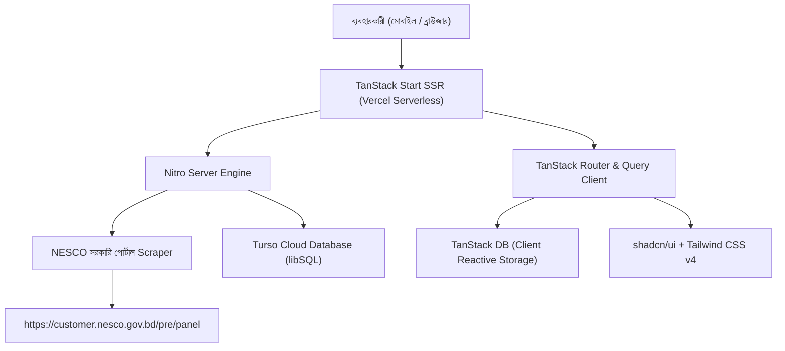

# ⚡ বিলবাড়ি (BillBari)
### প্রিমিয়াম ও মোবাইল-ফার্স্ট বিদ্যুৎ বিল ও রিচার্জ সহজ হিসাব প্ল্যাটফর্ম
> **A Modern, Mobile-First Electricity Bill & Prepaid Recharge Analytics Platform for NESCO (Northern Electricity Supply Company) Consumers in Bangladesh.**

[](https://billbari.vercel.app)
[](https://turso.tech)
[](https://tanstack.com/start)
[](https://ui.shadcn.com)
[](LICENSE)

---

## 🌍 বাস্তব প্রেক্ষাপট: এটি কেন দরকার? (Why BillBari?)

বাংলাদেশে রাজশাহী ও রংপুর বিভাগের ১৬টি জেলার লাখ লাখ পরিবার ও ব্যবসা প্রতিষ্ঠান **NESCO (Northern Electricity Supply Company)**-এর প্রিপেইড মিটার ব্যবহার করে। তবে প্রিপেইড বিদ্যুতের দৈনন্দিন ব্যবহারে সাধারণ গ্রাহকরা প্রতিনিয়ত নানা সমস্যায় পড়েন:

### 🛑 সাধারণ মানুষের বাস্তব সমস্যাগুলো (The Core Problems):

1. **সরকারি পোর্টালের জটিলতা ও ধীরগতি:**
   - সরকারি `customer.nesco.gov.bd/pre/panel` পোর্টালটি মোবাইল-বান্ধব নয়।
   - সার্ভার প্রায়শই ধীরগতির থাকে এবং রিচার্জ বা ব্যবহারের তথ্য সহজে বের করা যায় না।

2. **টোকেন হারিয়ে যাওয়ার বিভ্রান্তি:**
   - বিকাশে বা দোকানে রিচার্জের পর অনেক সময় এসএমএস আসে না বা ডিলিট হয়ে যায়। ২০ সংখ্যার গোপন টোকেন নম্বর হারিয়ে গ্রাহক বিদ্যুৎহীন অবস্থায় বিপাকে পড়েন।

3. **বিদ্যুৎ হঠাৎ বন্ধ হয়ে যাওয়ার ভয় (Blackout Anxiety):**
   - সাধারণ মানুষ জানে না মিটারে থাকা অবশিষ্ট টাকায় কয়দিন চলবে। 
   - মধ্যরাতে বা ছুটির দিনে ব্যালেন্স হঠাৎ শূন্য হয়ে বিদ্যুৎ বন্ধ হয়ে যায়, কারণ দৈনন্দিন খরচের কোনো রিয়েল-টাইম ট্র্যাকিং নেই।

4. **স্ল্যাব ট্যারিফের ধোঁয়াশা (The Tariff Trap):**
   - বাংলাদেশ এনার্জি রেগুলেটরি কমিশন (BERC)-এর আবাসিক **LT-A ট্যারিফ** অনুযায়ী বিদ্যুতের ইউনিট বাড়লে বিলের রেট ধাপ অনুযায়ী দ্বিগুণ-তিনগুণ পর্যন্ত বেড়ে যায় (লাইফলাইন ৪.৬৩ ৳/ইউনিট থেকে শুরু করে সর্বোচ্চ ১৪.৬১ ৳/ইউনিট)।
   - মাসের শুরুতে অসচেতন ব্যবহারের কারণে গ্রাহক পরবর্তী উচ্চ স্ল্যাবে উঠে যায় এবং বিশাল অঙ্কের বিল পরিশোধ করতে বাধ্য হয়। মানুষ বুঝতে পারে না তাদের বাড়তি বিল কেন এলো।

5. **যন্ত্রপাতিভিত্তিক খরচের স্বচ্ছতার অভাব:**
   - ১টি এসি চালালে মাসে কত খরচ বাড়ে? ফ্রিজ বা গিজার চালালে কত টাকা বিদ্যুৎ বিল আসে? অধিকাংশ পরিবারের কাছে এর কোনো সুস্পষ্ট ধারণা নেই।

---

## 💡 বিলবাড়ি (BillBari) কীভাবে সমাধান দিচ্ছে?

বিলবাড়ি একটি স্বয়ংসম্পূর্ণ, দ্রুতগতির ও সুন্দর মোবাইল প্ল্যাটফর্ম যা NESCO গ্রাহকদের হাতে তাদের বিদ্যুৎ ব্যবহারের পূর্ণ নিয়ন্ত্রণ তুলে দেয়:

* ⚡ **১-ক্লিকে রিচার্জ হিস্ট্রি ও টোকেন পুনরুদ্ধার:** মিটার নম্বর দেওয়া মাত্রই সরকারি ডাটাবেস থেকে পূর্ববর্তী সব রিচার্জের পরিমাণ, তারিখ এবং ২০-ডিজিটের ভেন্ডিং টোকেন চোখের সামনে চলে আসে।
* 📅 **বাকি দিন ও দৈনিক খরচের হিসাব (Smart Expense Burn Trajectory):** ব্যবহারকারীর প্রতিদিনের ব্যালেন্স ও রিডিং স্ন্যাপশট ট্র্যাক করে স্বয়ংক্রিয়ভাবে জানিয়ে দেয় মিটারে থাকা টাকায় আনুমানিক আর কয়দিন চলবে এবং দিনে গড়ে কত টাকা বিদ্যুৎ পুড়ছে।
* 📊 **ইন্টারেক্টিভ চার্ট ও সহজ দৃশ্যমানতা:** কোন মাসে কত ইউনিট (kWh) খরচ হলো এবং কত টাকা রিচার্জ লাগলো — তা মোবাইল স্ক্রিনে সুন্দর চার্টে দেখা যায়।
* 🪜 **স্ল্যাব প্রগ্রেস ট্র্যাকার (Slab Alert):** গ্রাহক বর্তমানে লাইফলাইন, ধাপ ১, ২, ৩ নাকি উচ্চ ধাপে অবস্থান করছেন তা স্পষ্ট গ্রাফ ও সতর্কবার্তার মাধ্যমে জানিয়ে দেওয়া হয়, যেন পরিবারগুলো সচেতনভাবে স্ল্যাব সীমার মধ্যে খরচ রাখতে পারে।
* 💡 **যন্ত্রপাতিভিত্তিক বিদ্যুৎ খরচ ক্যালকুলেটর:** ১.৫ টন এসি, রেফ্রিজারেটর, ওয়াটার হিটার কিংবা সিলিং ফ্যান প্রতিদিন নির্দিষ্ট ঘণ্টা চালালে আনুমানিক কত টাকা ও ইউনিট বিদ্যুৎ খরচ হবে তা ক্যালকুলেটরে হিসেব করা যায়।
* 🔒 **বাস্তব ডেটা ও অনুমানের সুস্পষ্ট পার্থক্য:** সরকারি NESCO পোর্টালের আসল তথ্য এবং গাণিতিক হিসাব বা অনুমানের মধ্যে সুস্পষ্ট পার্থক্য বজায় রাখা হয়েছে।
* 🌙 **পূর্ণাঙ্গ ডার্ক মোড ও সহজ বাংলা ভাষা:** কোনো জটিল বা ভারী শব্দ পরিহার করে প্রাত্যহিক জীবনের সহজ ভাষায় তৈরি, সাথে চোখের আরামের জন্য সার্বক্ষণিক ডার্ক মোড সাপোর্ট।

---

## 🚀 প্রধান ফিচারসমূহ (Key Features)

### ফ্রি — নেসকো পোর্টালে যা যা আছে, সবই

| ফিচার | বিবরণ |
| :--- | :--- |
| ⚡ **বর্তমান ব্যালেন্স** | মিটারে এখন কত টাকা আছে |
| 👤 **গ্রাহকের তথ্য** | নেসকোর রেকর্ডে থাকা সব তথ্য |
| ⚠️ **বকেয়া নোটিশ** | বকেয়া থাকলে সতর্কবার্তা |
| 📋 **রিচার্জ হিস্ট্রি ও টোকেন রসিদ** | সব রিচার্জ ও টোকেন; কপি, প্রিন্ট ও শেয়ার |
| 📅 **মাসিক ব্যবহার** | মাসভিত্তিক ইউনিট ও খরচ |
| 📄 **নেসকো PDF** | সার্টিফিকেট ও হিস্ট্রি ডাউনলোড |
| 🧭 **নেসকো সেবা** | রিচার্জ, অফিস, অভিযোগের লিংক |

### ফ্রি — বিলবাড়ির বাড়তি সুবিধা

| ফিচার | বিবরণ |
| :--- | :--- |
| 📊 **মৌলিক হিসাব** | গড় ব্যবহার, ট্যারিফ ধাপ, মাসিক তুলনা |
| 🧮 **ট্যারিফ তালিকা ও বিল ক্যালকুলেটর** | বিইআরসি এলটি-এ রেট; ইউনিট দিলে বিল |
| 🖨️ **প্রিন্ট** | হিস্ট্রি ও রসিদ প্রিন্ট |
| 🔎 **সাম্প্রতিক সার্চ** | এই ডিভাইসে আগের মিটার |
| 🎨 **৮টি থিম** | রং, আকার ও লেআউট বদলান |
| 🔖 **১টি মিটার সংরক্ষণ** | অ্যাকাউন্ট থাকলে |

### প্রো — মিটার প্লাস (৳২০ / ৩০ দিন) অথবা প্রিমিয়াম আনলিমিটেড (৳১০০ এককালীন)

দুই প্ল্যানেই একই ফিচার। কোন ফিচার কোন স্তরে, তার একমাত্র উৎস [`entitlements.ts`](src/features/payments/entitlements.ts)।

| ফিচার | বিবরণ |
| :--- | :--- |
| ⏳ **কয়দিন চলবে ও দৈনিক খরচ** | ব্যালেন্স শেষ হওয়ার দিন; দিনে গড়ে কত টাকা ও ইউনিট |
| 🪜 **ধাপ পূর্বাভাস** | মাস শেষে কোন ধাপে যাবেন |
| 💡 **ব্যক্তিগত পরামর্শ ও বিস্তারিত চার্ট** | ব্যবহারের ভিত্তিতে পরামর্শ; রিচার্জ ও ব্যবহারের ট্রেন্ড |
| 💰 **প্রকৃত ইউনিট দর** | চার্জসহ প্রতি ইউনিটের দাম |
| 🔁 **রিচার্জ অভ্যাস ও মৌসুমি প্রভাব** | গড় রিচার্জ, মাধ্যম, বিরতি; কোন মাসে খরচ বেশি-কম |
| 📸 **ব্যালেন্স স্ন্যাপশট** | দিনে দিনে ব্যালেন্স ট্র্যাকিং |
| 🌙 **স্বয়ংক্রিয় দৈনিক হিসাব** | প্রতি রাতে স্ন্যাপশট (ডিপ্লয়মেন্টে ক্রন শিডিউল করতে হবে, নিচে দেখুন) |
| 🗂️ **আনলিমিটেড মিটার ও সব মিটার একসাথে** | যত খুশি মিটার; সবগুলোর সর্বশেষ ব্যালেন্স |
| 🔔 **কম ব্যালেন্স সতর্কতা** | সীমার নিচে নামলে সতর্ক করে |
| 📤 **CSV এক্সপোর্ট** | এক্সেলে খোলার মতো ফাইল |
| 🔌 **যন্ত্রপাতি সিমুলেটর** | কোন যন্ত্রে কত খরচ |
| 🧾 **রিচার্জ প্ল্যানার ও সাশ্রয় পরিকল্পনা** | কত রিচার্জে কয়দিন; বিল কমানোর পরামর্শ |

লক করা ফিচারে ব্যবহারকারীর আসল সংখ্যা কখনো দেখানো হয় না (ব্লার করেও না)।

---

## 🎨 থিম ও কম্পোনেন্ট

৮টি পূর্ণ থিম, প্রতিটিতে লাইট ও ডার্ক মোড, সবই ফ্রি: **বিদ্যুৎ** (ডিফল্ট), **নিশি**, **খাতা**, **ধারালো**, **কোমল**, **কনসোল**, **সোনার বাংলা** ও **অরোরা**। থিম শুধু রং নয়, কোণ, ফন্ট, ঘনত্ব, লেআউট (বেন্টো / স্ট্যাক / স্প্লিট) ও ন্যাভিগেশনও বদলায়।

কম্পোনেন্ট নিয়ম (Base UI আগে):

1. shadcn-এ থাকলে তার **Base UI** সংস্করণ (`base-rhea` স্টাইল),
2. না থাকলে হাতে লেখা Base UI র‍্যাপার,
3. শুধু shadcn-এ থাকলে সেটি। `@radix-ui/*` বা `vaul` যোগ করা হয় না।

অ্যাপ কোডে কাঁচা HTML কন্ট্রোল, প্যালেট রং, হেক্স রং বা স্থির শ্যাডো নিষিদ্ধ (`pnpm lint` যাচাই করে)।

---

## 🏗️ টেক স্ট্যাক ও আর্কিটেকচার (Tech Stack)



- **Frontend & Fullstack SSR**: [TanStack Start](https://tanstack.com/start) + [Vite 8](https://vite.dev)
- **Routing & State**: [TanStack Router](https://tanstack.com/router) (Strict TypeScript Routes) + [TanStack Query](https://tanstack.com/query) v5
- **Client Reactive Data Layer**: [TanStack DB](https://tanstack.com/db) & `@tanstack/react-db`
- **UI Components & Theme**: [shadcn/ui](https://ui.shadcn.com) (`@base-ui/react` primitives), [Lucide React](https://lucide.dev), [next-themes](https://github.com/pacocoursey/next-themes) (Dark/Light mode), ৮টি থিম
- **Styling**: [Tailwind CSS v4](https://tailwindcss.com) with theme tokens
- **Charts & Visualizations**: [Recharts](https://recharts.org)
- **Server Database**: [Turso](https://turso.tech) (libSQL) via `@libsql/client` (Cloud HTTP/WebSocket & Local SQLite compatible)
- **Server Engine**: [Nitro](https://nitro.build) for seamless Vercel deployment with Fluid Compute
- **Testing**: [Vitest](https://vitest.dev)

---

## 📂 প্রোজেক্টের ফোল্ডার স্ট্রাকচার (Project Structure)

```
billbari/
├── src/
│   ├── components/            # রি-ইউজেবল UI কম্পোনেন্ট (shadcn/ui)
│   │   ├── ui/                # বাটন, কার্ড, ইনপুট, ডায়ালগ, টোস্ট, টেবিল
│   │   ├── app-header.tsx     # হেডার ও ডেস্কটপ ন্যাভিগেশন
│   │   ├── mobile-dock.tsx    # মোবাইল ডক
│   │   └── footer.tsx         # ফুটার ও কপিরাইট
│   ├── features/              # ফিচারভিত্তিক মডিউলার আর্কিটেকচার
│   │   ├── auth/              # লগইন, রেজিস্ট্রেশন, সেশন ও গুগল অথ
│   │   ├── db/                # সার্ভার ডাটাবেস (Turso/libSQL) ও ক্লায়েন্ট TanStack DB
│   │   ├── nesco/             # নেসকো পোর্টাল স্ক্র্যাপার, ক্যাশ ও রেফারেন্স ডেটা
│   │   ├── insights/          # প্রো বিশ্লেষণ পাতার অংশগুলো
│   │   ├── payments/          # এনটাইটেলমেন্ট, প্রো গেট ও বিকাশ
│   │   ├── snapshots/         # দৈনিক ব্যালেন্স স্ন্যাপশট ও বার্ন রেট হিসাব
│   │   ├── theme/             # থিম রেজিস্ট্রি ও অ্যাপিয়ারেন্স প্যানেল
│   │   └── tariffs/           # BERC LT-A স্ল্যাব লজিক ও অ্যাপ্লায়েন্স গাইড
│   ├── routes/                # TanStack ফাইল-বেসড টাইপড রুট
│   │   ├── __root.tsx         # রুট লেআউট ও প্রোভাইডারসমূহ
│   │   ├── index.tsx          # মূল ড্যাশবোর্ড ও মিটার সার্চ
│   │   ├── history.tsx        # বিস্তারিত রিচার্জ হিস্ট্রি ও টোকেন তালিকা
│   │   ├── insights.tsx       # প্রো বিশ্লেষণ
│   │   ├── snapshots.tsx      # দৈনিক ব্যালেন্স স্ন্যাপশট ও খরচ ট্র্যাকার
│   │   ├── help.tsx           # নেসকো সেবা ও সাধারণ প্রশ্ন
│   │   └── tariffs.tsx        # বিদ্যুতের মূল্য তালিকা ও ক্যালকুলেটর
│   ├── router.tsx             # রাউটার কনফিগারেশন
│   └── styles.css             # Tailwind v4 থিম ও ভ্যারিয়েবল
├── tests/                     # Vitest টেস্ট স্যুট (ইউনিট টেস্ট)
├── vite.config.ts             # Vite, Nitro, TanStack Start কনফিগারেশন
├── package.json
└── README.md
```

---

## ⚡ দ্রুত শুরু করার উপায় (Getting Started Locally)

### ১. প্রয়োজনীয় সফটওয়্যার
- **Node.js**: `>= 20.x`
- **pnpm**: `>= 9.x`

### ২. রিপোজিটরি ক্লোন ও প্যাকেজ ইনস্টলেশন
```bash
git clone https://github.com/rafiferdos/billbari.git
cd billbari
pnpm install
```

### ৩. এনভায়রনমেন্ট ভ্যারিয়েবল সেটআপ
`.env.example` ফাইলটি কপি করে `.env` তৈরি করুন:
```bash
cp .env.example .env
```

প্রয়োজনীয় মানগুলো পূরণ করুন:
```env
# ডাটাবেস (লোকাল টেস্টের জন্য ডিফল্ট SQLite ফাইল কাজ করবে, অথবা Turso URL)
TURSO_DATABASE_URL=file:data/billbari.db
TURSO_AUTH_TOKEN=

# সেশন সিকিউরিটি
SESSION_SECRET=your_super_secret_session_key_here

# পোর্টাল ইউআরএল
NESCO_PORTAL_URL=https://customer.nesco.gov.bd/pre/panel
```

### ৪. ডেভেলপমেন্ট সার্ভার চালু করুন
```bash
pnpm dev
```
ব্রাউজারে [http://localhost:3000](http://localhost:3000) ওপেন করুন।

### ৫. টেস্ট রান করুন
```bash
pnpm test
```
ইউনিট টেস্টগুলো ট্যারিফ, পার্সার, এনটাইটেলমেন্ট, থিম ও পেজ ভেরিফাই করবে।

### ৬. প্রোডাকশন বিল্ড তৈরি
```bash
pnpm build
```

---

## ☁️ Vercel-এ ডিপ্লয় করার নিয়ম (Deploy to Vercel)

বিলবাড়ি বিশেষভাবে Vercel Serverless Functions এবং Nitro ইঞ্জিনের সাথে সম্পূর্ণরূপে অপ্টিমাইজ করা:

1. [vercel.com](https://vercel.com)-এ যান এবং **Add New... > Project** নির্বাচন করুন।
2. GitHub থেকে `billbari` রিপোজিটরি ইম্পোর্ট করুন।
3. **Environment Variables** সেকশনে এই ভ্যালুগুলো যোগ করুন:
   - `TURSO_DATABASE_URL` = আপনার Turso ক্লাউড ডাটাবেস URL (উদা: `libsql://billbari-db-xxxx.turso.io`)
   - `TURSO_AUTH_TOKEN` = আপনার Turso ডাটাবেস Auth Token
   - `SESSION_SECRET` = যেকোনো সুরক্ষিত র্যান্ডম সিক্রেট কী
   - `BKASH_PERSONAL_NUMBER` = যে বিকাশ নম্বরে গ্রাহক টাকা পাঠাবেন (না দিলে কোডে বসানো একটি ডিফল্ট নম্বর দেখানো হয়)
   - `CRON_SECRET` = লম্বা র‍্যান্ডম স্ট্রিং (না দিলে `/api/cron/daily-pulse` সব অনুরোধ ফিরিয়ে দেয়)। রিপোজিটরিতে কোনো ক্রন শিডিউল নেই; রাতের স্ন্যাপশট চালু করতে নিজে শিডিউল করুন।
4. **Deploy** বাটনে চাপ দিন। ১ মিনিটের মধ্যেই সাইট লাইভ হয়ে যাবে!

---

## 🔐 নিরাপত্তা ও ডেটা প্রাইভেসি (Security & Privacy)

- 🔒 **পাসওয়ার্ড নিরাপত্তা:** ক্রিপ্টোগ্রাফিক সল্ট সহ `scrypt` অ্যালগরিদমের মাধ্যমে পাসওয়ার্ড হ্যাশ করে সংরক্ষণ করা হয়।
- 🍪 **এইচটিটিপি অনলি কুকিজ:** সেশন হাইজ্যাকিং রোধ করতে `httpOnly`, `sameSite: "lax"`, ও সুরক্ষিত কুকি ব্যবস্থাপনা।
- 🛡️ **কঠোর সত্যতা নীতি:** সরকারি লাইভ ডাটা ও গাণিতিক অনুমানের মধ্যে সুস্পষ্ট ডিসক্লেমার ও ভিজ্যুয়াল ব্যাজ প্রদর্শিত হয়। কোনো কৃত্রিম বিল বা ফেক ব্যালেন্স ডাটা তৈরি করা হয় না।

---

## 📜 লাইসেন্স (License)

প্রজেক্টটি **MIT License**-এর আওতায় প্রকাশিত। বিস্তারিত জানতে [LICENSE](LICENSE) ফাইল দেখুন।

---

<p align="center">
  <b>বিলবাড়ি (BillBari)</b> — বাংলাদেশের প্রতিটি প্রিপেইড বিদ্যুৎ গ্রাহকের জন্য সহজ হিসাব ও সচেতন বিদ্যুৎ ব্যবহারের বিশ্বস্ত সঙ্গী। 🇧🇩
</p>
